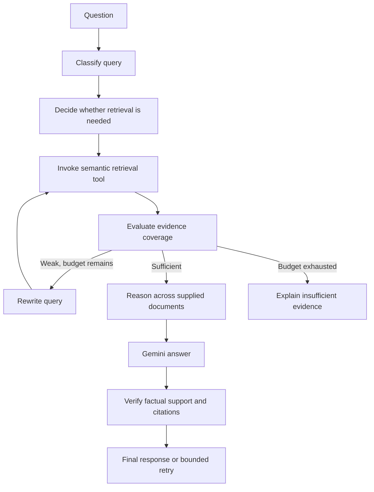

# Future Agentic RAG with LangGraph

The starter implements traditional RAG: validate → retrieve → build context → generate → check citation IDs. It intentionally has no agent loop and no LangGraph dependency.

An agentic extension can use the existing `Retriever.search` as a retrieval tool and `LLMProvider.generate` as its generation boundary. Define graph state containing the original question, rewritten query, selected document IDs, hits, evidence evaluation, answer, citations, retry counter and timing/token budget.

Add classification, rewriting, retrieval-quality evaluation and answer verification as separate nodes, with conditional edges and an explicit maximum of one or two re-retrievals. Evaluate evidence against the question rather than letting a model's unsupported confidence decide. Multi-document reasoning should retain source/page mappings throughout. Preserve the original question when rewriting, so the loop does not drift.

Traditional RAG has predictable latency and is easy to inspect. Agentic RAG can adapt to missing evidence but adds calls, cost, failure modes and harder debugging. Build an evaluation set and measure improvement before adding those loops. Do not grant tools the ability to execute instructions found in retrieved documents. Keep provider privacy checks, local retrieval, source verification and user-visible failure states.
